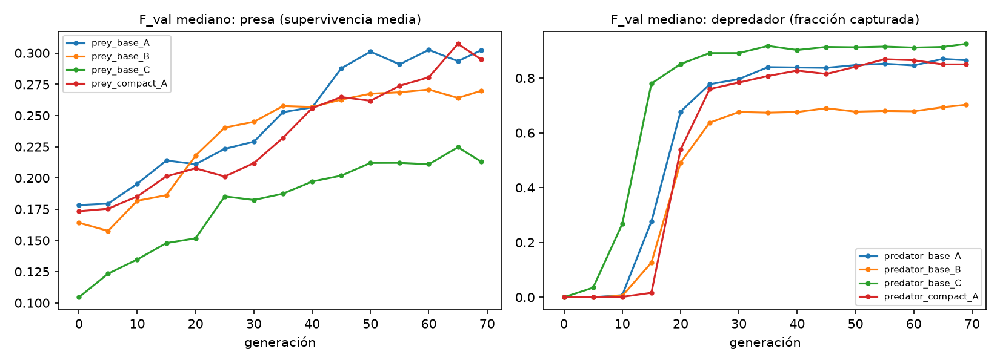
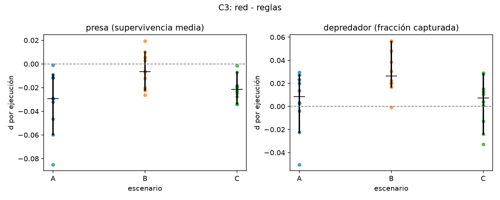

# NeuroEcosistema: neuroevolución de presas y depredadores en un ecosistema 2D

Informe final — Electiva I de Profundización: Inteligencia Artificial, Universidad Santo Tomás,
seccional Tunja. Autores: Andrés Gómez Gutiérrez y Nicolás Otero Vargas. Noviembre de 2026.

## 1. Problema y objetivo

Dos poblaciones de agentes autónomos —presas y depredadores— se mueven en un mundo 2D y deciden
en cada paso cuánto girar y a qué velocidad avanzar. La decisión la toma una red neuronal
multicapa cuyos pesos se ajustan por neuroevolución. El objetivo no es obtener el ecosistema
"más inteligente", sino mostrar con evidencia reproducible qué decisiones de modelado y de
entrenamiento funcionan, cuáles no y por qué. Se contrastan tres afirmaciones:

- **C1.** El entrenamiento mejora el desempeño de cada especie respecto a la red sin entrenar.
- **C2.** Una red compacta (≈ 1/3 de los parámetros) es no inferior a la red base.
- **C3.** La red entrenada se compara con una política escrita a mano (reglas).

## 2. Modelo del ecosistema

- **Mundo:** toroide de 150 × 150 sin paredes (ADR-002), T_max = 1000 pasos, sin reproducción
  dentro del episodio (ADR-003). Fases del paso en orden fijo (ADR-008); capturas y
  alimentación por emparejamiento voraz (ADR-009).
- **Energía (ADR-010):** costo basal más un costo cuadrático en la velocidad; las presas recuperan energía en
  plantas que rebrotan; los depredadores, al capturar. Una presa muere por captura o inanición.
- **Percepción (ADR-007):** cada objeto percibido se codifica como (p, p·sin φ, p·cos φ), con
  proximidad p = 1 − d/R_v y rumbo relativo φ; así no hay discontinuidad en el borde de la
  visión. La presa recibe 10 entradas (planta más cercana, los 2 depredadores más cercanos y
  su energía); el depredador, 7 (las 2 presas más cercanas y su energía).
- **Escenarios (ADR-029):** A abundancia (25 presas, 3 depredadores, 40 plantas); B escasez
  (4 plantas); C presión de depredación (5 depredadores). B y C cambian un único factor.
- **Calibración (P1, ADR-020/033/034):** los parámetros ecológicos se calibraron con criterios
  por clases antes de entrenar redes y se congelaron (tag `env-frozen-v1`). Toda la clase A
  se cumplió con semillas nuevas; dos criterios de clase B no cumplidos se aceptaron con
  justificación (ADR-034).

## 3. Redes y aprendizaje

| Red | Topología | Parámetros |
|---|---|---|
| Presa base / compacta | 10 → 16 → 16 → 2 / 10 → 8 → 8 → 2 | 482 / 178 |
| Depredador base / compacta | 7 → 16 → 16 → 2 / 7 → 8 → 8 → 2 | 434 / 154 |

- tanh en todas las capas; salidas → giro Δθ = o₀·ω_max y velocidad v = v_max·(o₁+1)/2
  (ADR-025). Inicialización de LeCun con varianza 1/fan_in, verificada (I1, I2; ADR-018).
- **Algoritmo genético (ADR-027):** población N = 40, élite k = 2 con reevaluación, torneo
  t = 3, mutación gaussiana, sin cruce; codificación directa de los pesos.
- **Aptitud (ADR-026):** presa, supervivencia media (fracción de pasos-presa vividos);
  depredador, fracción de presas capturadas. Cada especie se entrena frente al oponente por
  reglas; episodios de entrenamiento, validación y prueba con semillas disjuntas (ADR-028).
- **Selección del modelo:** el genoma élite con mayor F_val en validación (cada 5 generaciones,
  16 episodios); ante empate, el más temprano.
- **Currículo (ADR-026):** la red de depredador sin entrenar no captura nunca (98 % de
  evaluaciones con cero capturas en las primeras 10 generaciones de P2); sin señal no hay
  selección. El radio de captura de entrenamiento empieza en 2·r_capture (κ = 2) y baja
  linealmente hasta el nominal en 35 generaciones; validación y prueba usan el nominal.

## 4. Diseño experimental

Los hiperparámetros se fijaron con pilotos antes de los experimentos formales:

| Piloto | Pregunta | Resultado |
|---|---|---|
| P0 / P0b | Costo por paso y aceleración paralela | 0.38 ms/paso en A; forward de la red 2–7 % del paso; 6.4× con 16 procesos |
| P2 | σ, generaciones, currículo, Δ y θ (ADR-035) | σ = 0.10 en las 4 redes; G = 70; currículo activo; Δ y θ por especie |
| P3 | Duración de una ejecución completa | Σ t_run = 0.74 h → R = 10 cabe en el presupuesto de 45 h (ADR-004) |

El protocolo se prerregistró (`docs/experimental_protocol.md`, tag `protocol-v1`) antes de
cualquier ejecución formal: 8 configuraciones (redes base de ambas especies en A, B y C; redes
compactas en A) × R = 10 ejecuciones independientes = 80 ejecuciones; prueba con 50 episodios
TEST comunes a todas las condiciones frente a cinco oponentes (ADR-019): M0 reglas nominales,
M1/M2 variantes de reglas (umbral de huida ±0.1, crucero ×0.75/×1.25), M3 aleatorio y M4 juego
cruzado entre redes entrenadas.

**Análisis (ADR-017, ADR-013).** La unidad experimental es la ejecución (no el episodio). C1 y
C3: diferencia por ejecución, mediana con intervalo exacto por signos, prueba de signos exacta
y Holm con m = 6 por familia; Hodges-Lehmann y Wilcoxon como sensibilidad. C2: desplazamiento
de Hodges-Lehmann con intervalo exacto y regla de no inferioridad con margen Δ = 10 % de la
ganancia de entrenamiento observada en P2; eficiencia como generaciones hasta θ (permutación
exacta, Holm m = 2).

## 5. Resultados

Las 80 ejecuciones terminaron (7.3 h con 16 procesos, sin desviaciones del protocolo). Valores
medianos frente a M0 en las semillas TEST:

| Especie | Escenario | Antes de entrenar | Red entrenada | Reglas | Aleatoria |
|---|---|---|---|---|---|
| Presa (supervivencia) | A | 0.181 | 0.319 | 0.349 | 0.159 |
| | B | 0.167 | 0.294 | 0.300 | 0.153 |
| | C | 0.113 | 0.223 | 0.245 | 0.116 |
| Depredador (captura) | A | 0.000 | 0.866 | 0.858 | 0.000 |
| | B | 0.000 | 0.697 | 0.670 | 0.000 |
| | C | 0.000 | 0.926 | 0.918 | 0.000 |

**C1 — confirmada en los seis casos.** Las 10 ejecuciones mejoran en cada especie y escenario
(10/0/0, p signo = 0.002, p Holm = 0.012). Mejora mediana de la presa: +0.140 (A), +0.122 (B),
+0.110 (C); del depredador: +0.866, +0.697, +0.926. Hodges-Lehmann coincide.

**C3 — depende de la especie.**

| Especie | Escenario | k⁺/k⁰/k⁻ | Mediana d (red − reglas) | IC 97.9 % | p Holm |
|---|---|---|---|---|---|
| Presa | A | 0/0/10 | −0.029 | [−0.060, −0.009] | 0.012 |
| Presa | B | 4/0/6 | −0.006 | [−0.022, 0.010] | 1.000 |
| Presa | C | 0/0/10 | −0.021 | [−0.034, −0.007] | 0.012 |
| Depredador | A | 7/0/3 | +0.008 | [−0.022, 0.027] | 1.000 |
| Depredador | B | 9/0/1 | +0.026 | [0.017, 0.056] | 0.086 |
| Depredador | C | 7/0/3 | +0.007 | [−0.024, 0.028] | 1.000 |

El depredador entrenado alcanza a las reglas en los tres escenarios y las supera en B (escasez),
aunque esa ventaja no resiste la corrección de Holm. La presa entrenada queda por debajo de las
reglas en A y C de forma significativa y empata en B.

**C2 — no inferioridad de la red compacta.**

| Especie | δ HL (compacta − base) | IC exacto | Margen Δ | Veredicto | Eficiencia (p Holm) |
|---|---|---|---|---|---|
| Presa | −0.009 | [−0.042, 0.016] | 0.010 | Inconcluso | 0.31 |
| Depredador | −0.003 | [−0.020, 0.016] | 0.084 | No inferior | 0.32 |

Con un tercio de los parámetros, el depredador compacto es no inferior. Para la presa el
intervalo cruza −Δ: no se puede afirmar ni negar la no inferioridad. No hay diferencia en el
número de generaciones hasta θ.

**Generalización (ADR-019).** La presa entrenada solo supera a las reglas frente al depredador
aleatorio M3 (A: +0.048, IC [0.016, 0.107]); frente a M1, M2 y M4 mantiene la desventaja de M0
en A y C. La ventaja del depredador en B se conserva frente a M2 (+0.043) y frente a las presas
entrenadas M4 (+0.027); en C frente a M1 tiende a perder (−0.026, IC [−0.057, 0.003]).

Figuras: `results/experiments/f8/analysis/` (`c1_differences.png`, `c3_differences.png`,
`validation_curves.png`).

## 6. Interpretación (ADR-036)

1. **La neuroevolución aprende en las dos especies**, pero el punto de partida es distinto: la
   red de depredador sin entrenar no captura nunca y sin el currículo no había señal; la presa
   parte de la supervivencia de una política aleatoria. El currículo fue decisivo para el
   depredador: las curvas de validación muestran el despegue entre las generaciones 10 y 20.
2. **Perseguir es un problema más fácil que huir.** El depredador iguala o supera las reglas
   con 434 parámetros y 70 generaciones; la presa no. Para el depredador basta una regla de
   persecución que la red reproduce; la presa debe equilibrar alimentarse y huir con
   información parcial (dos depredadores y una planta, sin ver a otras presas).
3. **La presa todavía estaba aprendiendo.** Las curvas de validación de la presa no se
   aplanan como las del depredador: suben hasta las últimas generaciones, y 8 de las 10
   ejecuciones de la presa compacta (8 de 10 también en la presa base en C) seleccionan el
   modelo en las dos últimas validaciones (generaciones 65 y 69). El estancamiento de P2 se estimó con 60 generaciones y 2
   ejecuciones, lo que subestimó el presupuesto necesario. C3 negativo para la presa refleja
   entrenamiento insuficiente, no un límite demostrado de la red.
4. **Especialización frente al oponente de entrenamiento.** La presa entrenada supera a las
   reglas solo frente al depredador aleatorio: aprendió a evitar al depredador en general,
   pero la política por reglas de huida está mejor ajustada a perseguidores deterministas.
5. **La capacidad no es el cuello de botella del depredador** (C2 no inferior); para la presa
   el margen Δ = 0.010 es estrecho frente a la variabilidad entre ejecuciones (rango de 0.25 a
   0.35 en F_val), por lo que R = 10 no basta para decidir.
6. **B (escasez) es el escenario más favorable a la red de depredador**: con pocas plantas las
   presas se dispersan y la persecución adaptativa rinde más que la regla de crucero.

## 7. Mejora propuesta (ADR-037)

La primera decisión que se modificaría es el **presupuesto de entrenamiento de la presa**
(G y oponentes de entrenamiento), con esta evidencia: curvas de validación que no se aplanan
antes de la generación 70, selección del modelo en las dos últimas validaciones (8 de 10
ejecuciones de la presa compacta y de la presa base en C) y desventaja frente a las
reglas concentrada en los oponentes deterministas. Se propone G ≥ 150 para la presa con la
regla de estancamiento medida sobre R ejecuciones (no 2), y entrenar frente a una mezcla
M0/M1/M2 para reducir la especialización. Después, para C2 de la presa, aumentar R o fijar Δ a
partir de un criterio sustantivo y no solo del 10 % de la ganancia.

## 8. Limitaciones

- R = 10 ejecuciones por configuración; resultados de una sola máquina (reproducibilidad bit a
  bit en la misma máquina; entre máquinas, estadística, ADR-016).
- Cada especie se entrena frente a reglas fijas (sin coevolución, ADR-006).
- Los hiperparámetros salen de pilotos pequeños (2 ejecuciones por celda en P2).
- C2 solo en el escenario A (ADR-005); la comparación con reglas depende de lo bien ajustadas
  que estén estas (se calibraron en P1 como oponente razonable, no como óptimo).

## 9. Ingeniería y reproducibilidad

- Clean Architecture con contratos verificados (`lint-imports`, pruebas de arquitectura); el
  dominio solo usa la biblioteca estándar y NumPy.
- 1074 pruebas automáticas e integración continua en cada cambio de código.
- Toda la aleatoriedad deriva de `project_seed` con claves de seis enteros (ADR-028);
  determinismo verificado con 0, 1 y 4 procesos (DET-3).
- Resultados en CSV y JSON con procedencia (commit, configuración, versiones) en cada
  ejecución. El análisis completo se regenera desde `test_episodes.csv` con
  `uv run neuroeco experiment analyze`.
- Bitácora de 37 decisiones en `docs/decisions/` (ADR-001 a ADR-037).

## 10. Uso de IA generativa

Se usó Claude Code (Anthropic) para diseño, implementación, pruebas, análisis y redacción, con
revisión y decisiones de los autores. Las propuestas corregidas o rechazadas y las validaciones se
registran en `docs/ai_usage_statement.md`.
