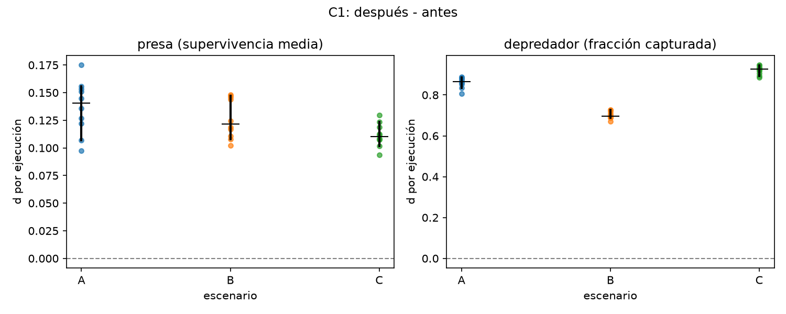
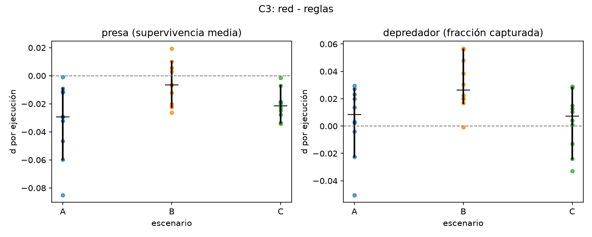
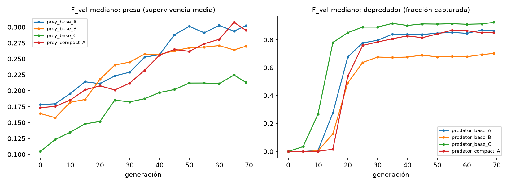

# Resultados de F8 (generado por `neuroeco experiment analyze`)

Ejecuciones planificadas por configuración: R = 10.

### C1: después frente a antes de entrenar (frente a M0)

| Especie | Escenario | n | k⁺/k⁰/k⁻ | Mediana d | IC exacto (nivel) | p signo | p Holm | HL (sensibilidad) |
|---|---|---|---|---|---|---|---|---|
| prey | A | 10 | 10/0/0 | 0.1403 | [0.1068, 0.1557] (97.9 %) | 0.0020 | 0.0117 | 0.1379 [0.1212, 0.1535] |
| prey | B | 10 | 10/0/0 | 0.1215 | [0.1080, 0.1471] (97.9 %) | 0.0020 | 0.0117 | 0.1272 [0.1124, 0.1447] |
| prey | C | 10 | 10/0/0 | 0.1100 | [0.1016, 0.1234] (97.9 %) | 0.0020 | 0.0117 | 0.1104 [0.1046, 0.1189] |
| predator | A | 10 | 10/0/0 | 0.8660 | [0.8352, 0.8848] (97.9 %) | 0.0020 | 0.0117 | 0.8656 [0.8436, 0.8792] |
| predator | B | 10 | 10/0/0 | 0.6968 | [0.6872, 0.7264] (97.9 %) | 0.0020 | 0.0117 | 0.7008 [0.6888, 0.7140] |
| predator | C | 10 | 10/0/0 | 0.9256 | [0.8936, 0.9456] (97.9 %) | 0.0020 | 0.0117 | 0.9224 [0.9064, 0.9372] |

### C3: red entrenada frente a la política por reglas (frente a M0)

| Especie | Escenario | n | k⁺/k⁰/k⁻ | Mediana d | IC exacto (nivel) | p signo | p Holm | HL (sensibilidad) |
|---|---|---|---|---|---|---|---|---|
| prey | A | 10 | 0/0/10 | -0.0292 | [-0.0597, -0.0090] (97.9 %) | 0.0020 | 0.0117 | -0.0292 [-0.0485, -0.0116] |
| prey | B | 10 | 4/0/6 | -0.0064 | [-0.0224, 0.0100] (97.9 %) | 0.7539 | 1.0000 | -0.0062 [-0.0165, 0.0064] |
| prey | C | 10 | 0/0/10 | -0.0214 | [-0.0336, -0.0072] (97.9 %) | 0.0020 | 0.0117 | -0.0214 [-0.0283, -0.0130] |
| predator | A | 10 | 7/0/3 | 0.0084 | [-0.0224, 0.0272] (97.9 %) | 0.3438 | 1.0000 | 0.0080 [-0.0136, 0.0216] |
| predator | B | 10 | 9/0/1 | 0.0264 | [0.0168, 0.0560] (97.9 %) | 0.0215 | 0.0859 | 0.0304 [0.0184, 0.0436] |
| predator | C | 10 | 7/0/3 | 0.0072 | [-0.0240, 0.0280] (97.9 %) | 0.3438 | 1.0000 | 0.0040 [-0.0116, 0.0192] |

### C2: red compacta frente a red base (escenario A)

| Especie | δ (HL) | IC exacto | Margen Δ | Veredicto | δ de Cliff | G_θ base | G_θ compacta | p eficiencia (Holm) |
|---|---|---|---|---|---|---|---|---|
| prey | -0.0089 | [-0.0419, 0.0156] | 0.0104 | inconclusive | -0.240 | [75, 45, 55, 35, 35, 15, 40, 50, 50, 35] | [75, 25, 35, 55, 40, 75, 75, 65, 75, 45] | 0.3086 |
| predator | -0.0028 | [-0.0200, 0.0160] | 0.0843 | non_inferior | -0.110 | [25, 30, 35, 25, 15, 20, 20, 30, 25, 35] | [20, 40, 25, 25, 55, 30, 25, 40, 35, 20] | 0.3169 |

### Generalización (ADR-019): ventaja de la red sobre las reglas, Adv(O)

| Especie | Escenario | Oponente | Mediana Adv | IC exacto por signos |
|---|---|---|---|---|
| prey | A | M0 | -0.0292 | [-0.0597, -0.0090] |
| prey | A | M1 | -0.0260 | [-0.0434, -0.0084] |
| prey | A | M2 | -0.0396 | [-0.0639, -0.0120] |
| prey | A | M3 | 0.0483 | [0.0157, 0.1069] |
| prey | A | M4 | -0.0159 | [-0.0437, -0.0084] |
| prey | B | M0 | -0.0064 | [-0.0224, 0.0100] |
| prey | B | M1 | 0.0002 | [-0.0116, 0.0258] |
| prey | B | M2 | -0.0050 | [-0.0277, 0.0045] |
| prey | B | M3 | 0.0011 | [-0.0481, 0.0228] |
| prey | B | M4 | 0.0004 | [-0.0213, 0.0191] |
| prey | C | M0 | -0.0214 | [-0.0336, -0.0072] |
| prey | C | M1 | -0.0148 | [-0.0249, -0.0057] |
| prey | C | M2 | -0.0303 | [-0.0374, -0.0144] |
| prey | C | M3 | 0.0403 | [-0.0556, 0.1012] |
| prey | C | M4 | -0.0076 | [-0.0174, -0.0011] |
| predator | A | M0 | 0.0084 | [-0.0224, 0.0272] |
| predator | A | M1 | 0.0000 | [-0.0144, 0.0112] |
| predator | A | M2 | -0.0012 | [-0.0200, 0.0096] |
| predator | A | M3 | 0.0064 | [-0.0192, 0.0288] |
| predator | A | M4 | 0.0099 | [-0.0217, 0.0195] |
| predator | B | M0 | 0.0264 | [0.0168, 0.0560] |
| predator | B | M1 | 0.0024 | [-0.0128, 0.0280] |
| predator | B | M2 | 0.0428 | [0.0128, 0.0568] |
| predator | B | M3 | 0.0040 | [-0.0040, 0.0208] |
| predator | B | M4 | 0.0272 | [0.0010, 0.0449] |
| predator | C | M0 | 0.0072 | [-0.0240, 0.0280] |
| predator | C | M1 | -0.0264 | [-0.0568, 0.0032] |
| predator | C | M2 | -0.0128 | [-0.0424, 0.0008] |
| predator | C | M3 | 0.0016 | [-0.0144, 0.0128] |
| predator | C | M4 | -0.0089 | [-0.0545, 0.0166] |

